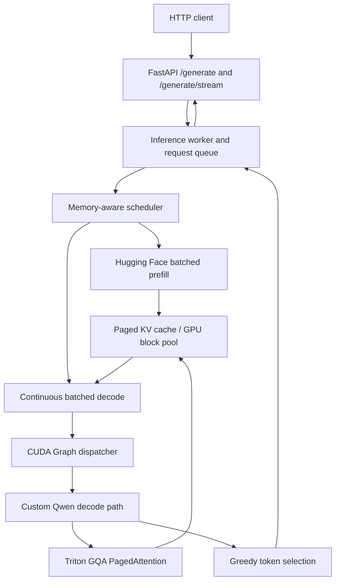

# TinyServe

**A single-GPU LLM inference server built to explore the mechanics and performance of modern serving systems.**

TinyServe serves **Qwen3-0.6B-Base** with a custom paged KV-cache, Triton PagedAttention, continuous request batching, CUDA Graph–accelerated decoding, and a FastAPI HTTP/streaming interface. It combines a Hugging Face–based **batched prefill** path with a custom **paged decode** path.

Rather than presenting TinyServe as a replacement for a production engine, this project focuses on implementing key serving primitives, verifying numerical and end-to-end correctness, and using measurements to identify and remove bottlenecks.

## Highlights

- **Paged KV cache:** logical-to-physical block mapping, reusable GPU KV storage, and per-request allocation/release (16-token blocks).
- **Triton PagedAttention:** a custom grouped-query attention (GQA) decode kernel that reads KV from noncontiguous physical blocks.
- **Continuous batching:** requests enter and leave the active decode batch as generation progresses.
- **CUDA Graph decode:** graph capture/replay for supported batch sizes **1, 2, 4, 8, 16, and 32**, reducing repeated decode launch overhead.
- **Batched prefill:** left-padded variable-length prompts, explicit attention masks and position IDs, then transfer of non-padding KV entries into the paged cache.
- **HTTP serving:** synchronous generation and server-sent-event (SSE) token streaming through a dedicated inference worker.
- **Testing and profiling:** reference comparisons, CUDA Graph and PagedAttention tests, concurrency checks, HTTP load tests, and a vLLM baseline.

## Performance snapshot

On an **NVIDIA GeForce RTX 5070 Ti (16 GB)** using **Qwen3-0.6B-Base in FP32**:

| Engine / configuration | Output throughput | Median TTFT | Median request latency |
| --- | ---: | ---: | ---: |
| TinyServe — sequential prefill baseline | 1,294.2 tokens/s | 474.5 ms | 788.1 ms |
| TinyServe — batched prefill (32), batched argmax | **2,442.4 tokens/s** | **117.8 ms** | **416.9 ms** |
| vLLM — comparison baseline | 4,880.8 tokens/s | 30.7 ms | 205.2 ms |

The final TinyServe configuration reached **1.89×** its initial end-to-end throughput on the measured workload. vLLM achieved approximately **2.0×** TinyServe's throughput under the same client-side workload. These measurements are **not** generalized performance claims.

**Workload:** 64 total requests, HTTP concurrency 32, up to 32 new tokens/request (2,048 tokens generated in the recorded trials), five trials with two warmup rounds. All throughput values are output tokens per second, measured at the client. See **[Benchmark methodology and full results](docs/BENCHMARKS.md)** for test conditions, intermediate experiments, metric definitions, and caveats.

## Architecture



### Request lifecycle

1. **Admission:** the scheduler admits new requests subject to the engine's configured capacity.
2. **Prefill:** variable-length prompts are left-padded and processed in a batched Hugging Face forward pass; masks and position IDs preserve per-request token positions.
3. **KV transfer:** the prefill-produced K/V for real prompt positions is copied into each request's paged KV blocks. The prefill logits also yield the first output token.
4. **Decode:** active requests are batched. The custom path uses paged KV storage, Triton attention, and the CUDA Graph dispatcher when enabled.
5. **Completion:** on EOS or the output-token limit, request state and KV blocks are released. The HTTP layer returns the result or streams token events.

### Design notes

- **Paged KV allocation** separates each request's logical positions from the GPU blocks holding K/V. This supports independent sequence lengths and block reuse as requests finish.
- **Grouped-query PagedAttention** handles multiple query heads sharing KV heads; the decode kernel accesses block tables rather than requiring a single contiguous KV tensor per request.
- **CUDA Graphs** accelerate recurring decode shapes; they do not capture the Hugging Face prefill path.
- **Batched prefill is a distinct optimization from batched decode.** Initial versions performed one Hugging Face forward per request, creating a substantial concurrency bottleneck. Batching those forwards improved first-token latency and end-to-end throughput.

## Getting started

### Requirements

- Linux with a CUDA-capable NVIDIA GPU (developed and benchmarked on Ubuntu 24.04 with RTX 5070 Ti).
- Python environment compatible with the project's `requirements.txt` and installed CUDA/PyTorch/Triton stack.
- Access to the `Qwen/Qwen3-0.6B-Base` model on Hugging Face; weights download on first use if not cached.

From the repository root, activate your environment and install the listed dependencies:

```bash
python -m venv .venv
source .venv/bin/activate
pip install -r requirements.txt
```

> CUDA, PyTorch, and Triton versions must be compatible with your GPU/driver. The published performance results reflect the author's tested machine and are not guaranteed by a fresh installation.

### Start the API

```bash
python -m uvicorn server.api:app --host 127.0.0.1 --port 8000
```

The server exposes `/health`, `/generate`, and `/generate/stream`.

### Generate text

```bash
curl -s http://127.0.0.1:8000/generate \
  -H 'Content-Type: application/json' \
  -d '{"prompt":"The capital of Canada is","max_new_tokens":16}'
```

The JSON response includes a request identifier and generated token IDs. Token decoding and any additional response fields are defined in `server/api.py`.

### Stream tokens

```bash
curl -N http://127.0.0.1:8000/generate/stream \
  -H 'Content-Type: application/json' \
  -d '{"prompt":"Artificial intelligence is","max_new_tokens":32}'
```

The streaming endpoint emits SSE events such as `token`, `done`, and `error`.

## Verify correctness

The project contains standalone test modules under `tests/`. For example:

```bash
python -m tests.test_triton_batched_paged_attention
python -m tests.test_qwen_paged_decode
python -m tests.test_qwen_cuda_graph
python -m tests.test_continuous_batch_engine
python -m tests.test_qwen_multi_request
```

With the API running in another terminal:

```bash
python -m tests.test_http_concurrency
```

These tests exercise numerical comparisons, paged cache behavior, CUDA Graph replay, request lifecycle, and concurrent response consistency. Individual tests are standalone scripts, not necessarily a single `pytest` suite. The final development test run was reported passing; results still depend on the runtime and installed dependencies.

## Run the HTTP benchmark

With TinyServe running on port 8000:

```bash
python -m benchmarks.bench_compare_serving \
  --backend tinyserve --concurrency 32 \
  --requests 64 --max-tokens 32 --trials 5
```

For the vLLM comparison, start vLLM **instead of TinyServe**, on the same GPU, and benchmark its OpenAI-compatible completions endpoint:

```bash
python -m benchmarks.bench_compare_serving \
  --backend vllm --concurrency 32 \
  --requests 64 --max-tokens 32 --trials 5
```

The client expects TinyServe at `127.0.0.1:8000` and vLLM at `127.0.0.1:8001`. Do not run both servers on the GPU during measurements. The workload reuses the prompt templates defined in `benchmarks/bench_http_serving.py`. Details and the tested vLLM configuration are in [docs/BENCHMARKS.md](docs/BENCHMARKS.md).

## Repository structure

```text
engine/
  continuous_batch_engine.py       # Request prefill/decode lifecycle
  cuda_graph_dispatcher.py         # Decode graph selection/replay
  kv_cache_manager.py              # Physical block management
  kv_cache_pool.py                 # GPU KV storage
  paged_kv_cache.py                # Per-request paged cache
  qwen_paged_batch_runner.py       # Batched Qwen decode
  triton_batched_paged_attention.py # Triton GQA attention
  triton_kv_write.py               # Device-side KV writes
  scheduler.py                     # Admission and capacity handling
server/
  api.py                           # FastAPI endpoints
  runtime.py                       # Inference worker + streaming
benchmarks/
  bench_compare_serving.py         # TinyServe / vLLM HTTP comparison
  bench_batch_scaling.py           # Concurrency and batch experiments
  ...
tests/                             # Standalone correctness tests
docs/BENCHMARKS.md                  # Methodology and recorded results
```

## Scope and limitations

TinyServe is a **research/educational single-GPU serving implementation**, not a production-ready drop-in replacement for vLLM. Current scope includes a Qwen3-0.6B-specific custom decode path, greedy token generation, fixed graph batch sizes, and bounded context/cache capacity. Prefill still uses Hugging Face and currently transfers prompt KV into the paged cache through a Python loop; longer-context workloads have not been characterized to the same depth as the short-prompt benchmark. Robust cancellation on client disconnect, broader model support, distributed serving, and production operational hardening are outside the v1.0 scope.

This project prioritizes transparent architecture, correctness testing, and reproducible optimization work over maximum benchmark throughput.
